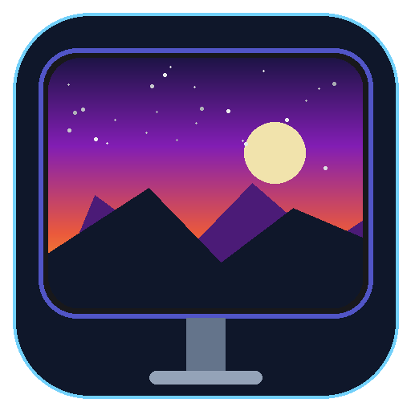

# ⚡ Desktop Utility Suite

<div align="center">



### Modern Desktop Automation, 4K TV Wallpaper Sync & Offline File Organization

[](https://github.com/ashugit1234622/wallpaper-selector/releases)
[-success.svg?style=for-the-badge&logo=pytest&logoColor=white)](tests/)
[](https://www.python.org/)
[](https://opensource.org/licenses/MIT)
[](https://github.com/ashugit1234622/wallpaper-selector)

**A high-performance, modular desktop utility suite featuring intelligent Ultra-HD wallpaper rotation, CleanMy-TV 4K Smart TV synchronization, and a zero-risk offline Download Folder Organizer with live preview, collision protection, and durable rollback.**

[⚡ Quick Install](#-quick-installation) • [✨ Suite Highlights](#-suite-tools--key-features) • [📺 4K TV & CleanMy-TV](#-4k-tv-mode--cleanmy-tv-synchronization) • [🚀 Usage & CLI](#-usage-guide--cli-reference) • [🏗️ Architecture](#-system-architecture) • [🧪 Testing](#-testing--quality-assurance) • [❓ FAQ](#-troubleshooting--faq) • [📜 License](#-license)

---

</div>

## ⚡ Quick Installation

Choose your platform below to get up and running in under a minute.

### Option 1: Windows Setup `.exe` Installer (No Python Required)

1. Download **`Desktop-Utility-Suite-v2.0.0-Setup.exe`** from [GitHub Releases](https://github.com/ashugit1234622/wallpaper-selector/releases).
2. Double-click the installer to launch the modern setup wizard.
3. Automatically sets up the app in your user profile, creates Desktop & Start Menu shortcuts, registers an uninstaller in Windows Settings, and optionally enables login autostart!

*To compile the installer executable from source:*
```powershell
powershell -ExecutionPolicy Bypass -File .\build_installer.ps1
```

---

### Option 2: Windows 1-Click PowerShell (From Source)

Open **PowerShell** (no Administrator privileges required) and run:

```powershell
git clone https://github.com/ashugit1234622/wallpaper-selector.git
cd wallpaper-selector
powershell -ExecutionPolicy Bypass -File .\install.ps1
```

#### What the PowerShell Installer Does Automatically:
1. Installs all required dependencies (`customtkinter`, `pillow`, `httpx`, `platformdirs`, `pywin32`, `pystray`) into your user environment.
2. Creates a desktop shortcut **`Desktop Utility Suite.lnk`** with the bundled high-resolution icon.
3. Sets up a user PATH shim `login-wallpaper-selector` in `%LOCALAPPDATA%\Microsoft\WindowsApps`.
4. Registers user login autostart in `HKCU\Software\Microsoft\Windows\CurrentVersion\Run`.
5. Runs an automated system health check verifying desktop adapters, CleanMy-TV bridge, and provider APIs.

---

### Option 3: Linux & macOS (Native Bash)

Open terminal and run:

```bash
git clone https://github.com/ashugit1234622/wallpaper-selector.git
cd wallpaper-selector
chmod +x install.sh
./install.sh
```

Sets up the package, places a command-line launcher in `~/.local/bin/login-wallpaper-selector`, registers desktop autostart, and executes verification tests.

---

### Option 4: Python Pip / Developers

```bash
git clone https://github.com/ashugit1234622/wallpaper-selector.git
cd wallpaper-selector
pip install -e .
```

*Or install directly from GitHub without cloning:*
```bash
pip install git+https://github.com/ashugit1234622/wallpaper-selector.git
```

---

## ✨ Suite Tools & Key Features

The suite features a persistent left navigation sidebar allowing instant switching between independent desktop utilities without window duplication, flicker, or application restart.

```
+---------------------------------------------------------------------------------+
|  ⚡ DESKTOP UTILITY SUITE v2.0                                      [_] [X]     |
+-------------------+-------------------------------------------------------------+
|                   |                                                             |
|  [🖼️ Wallpapers]  |  🔍 [ Search Wallpapers... ]  [ 📺 4K TV: ON ]  [🎲 Fetch]  |
|                   |  Category: [Nature | Space | Art | Portrait]   Mood: [Calm] |
|  [📁 Organizer]   |  Palette:  [Dominant Blue]                     Mode: [Fill] |
|                   |                                                             |
|  ---------------- |  +-------------------------------------------------------+  |
|  [⚙️ Settings]    |  |               SCREEN-FIT LIVE PREVIEW                 |  |
|  [🔄 Update]      |  |             (Ultra-HD 3840x2160 Display)              |  |
|  [❓ About]       |  +-------------------------------------------------------+  |
|                   |  [⭐ Favorite] [💾 Save to Folder] [ Apply to Desktop ]     |
+-------------------+-------------------------------------------------------------+
```

---

### 1. 🖼️ Intelligent Wallpaper Manager

* **📺 4K TV Mode & Dedicated Repository**:
  * Features a dedicated **4K UHD Curated Repository** delivering pre-verified $\ge 3840 \times 2160$ landscape wallpapers from ultra-fast CDNs with dynamic open-access 4K archive search.
  * Strict 16:9 widescreen aspect ratio verification eliminates vertical bars and distortion on big screens.
  * Connects directly with **CleanMy-TV** over ADB network bridge to push and set wallpapers on Android TV / Smart TV screens with automated 16:9 cropping and letterbox prevention.
* **🔍 5-Tier Adaptive Keyword Search**:
  * Progressively augments queries through 5 semantic tiers across **Wallhaven**, **NASA**, **The Met**, **Art Institute of Chicago**, **Bing Daily**, and **Wikimedia Commons**.
* **🎨 Color & Mood Harmonization**:
  * Filter by dominant palette (*Blue, Purple, Green, Warm, Monochrome*) and aesthetic vibes (*Calm, Dark, Epic, Minimal, Vivid, Cinematic*).
* **⏰ Time-of-Day (TOD) Dynamic Themes**:
  * Automatically shifts wallpaper ambiance based on solar cycle (*Dawn, Day, Golden Hour, Dusk, Night*) with manual override and harmonized query synthesis.
* **⌨️ Global Instant Hotkey**:
  * Press **`Ctrl+Alt+W`** (or your custom combination) anywhere in Windows to immediately cycle your desktop wallpaper—even while background auto-rotation is running. Hotkey specifically targets native desktop resolution without interrupting TV sync.
* **🛑 Responsive Progress & Stop Button**:
  * Integrated cancel button allows immediately stopping long image queries or heavy 4K downloads while keeping the UI responsive.
* **⚡ Debounced Fluent UI Engine**:
  * Optimized Windows 11 layout engine with debounced window resizing and canvas fitting, ensuring silky-smooth 60fps window adjustment without lag.
* **🖥️ Screen-Fit Live Preview & Icon-Aware Crop**:
  * True-to-scale mockups with *Fill* (proportional cover) and *Fit* (pillarbox/letterbox) modes, plus layout-aware crop alignment away from desktop icon clusters.
* **⭐ Favorites & Local Storage Gallery**:
  * 1–5 star rating system, favorites shuffling, and 1-click offline library saving into categorized directories.
* **🔄 Anti-Repetition Daemon**:
  * Background scheduler with persistent history tracking to guarantee no duplicate images within your rotation window.

---

### 2. 📁 Download Folder Organizer

* **🔒 Deterministic Offline Classifier**:
  * Extensible rule engine sorting files across 9 categories: *Documents, Images, Videos, Audio, Archives, Installers, Code & Dev, Spreadsheets & Data, Presentations*.
  * Built-in support for compound extensions (`.tar.gz`, `.user.js`) and custom user-defined mappings.
  * **100% Offline & Private**: Operates strictly on local metadata without uploading file contents anywhere.
* **📊 Real-Time KPI Dashboard**:
  * 5 summary cards displaying *Discovered Files, Categorized Files, Proposed Moves, Conflicts / Review, and Total Size*.
* **📂 3 Selectable Organization Modes**:
  * **By File Type**: Clean subfolders (`Images/`, `Documents/`, etc.).
  * **By Date**: Chronological `YYYY/MM/` subfolders based on creation/modification time.
  * **By Type and Date**: Category folders with nested chronological subfolders.
* **🛡️ Pre-Execution Preview & Collision Protection**:
  * Interactive checklist with per-file checkboxes, destination paths, size, and search filters. Files are **never** moved without user approval.
  * **Keep Both** resolution automatically appends unique numbering (`file (1).ext`) for both on-disk duplicates and in-batch name collisions.
* **↩️ Durable Undo Engine**:
  * Persistent JSON transaction journal in `%LOCALAPPDATA%`. The **"Undo Last Batch"** button verifies file integrity and restores moved files back to their exact original locations.

---

## 📺 4K TV Mode & CleanMy-TV Synchronization

The suite includes built-in synchronization with **CleanMy-TV** to power ambient TV backgrounds and smart displays:

```
[ Desktop Utility Suite ] ──( search_for_tv=True )──> [ Dedicated 4K UHD Repository ]
          │                                                       │
          │ ( 16:9 Crop / Letterbox Guard )                       │ ( 3840x2160+ Image )
          ▼                                                       ▼
  [ TvBridge ] ──( ADB over WiFi: Port 5555 )──> [ CleanMy-TV on Android TV ]
```

1. **How It Works**:
   - Toggling the **📺 TV** switch activates `search_for_tv=True`.
   - The provider router prioritizes the **4K UHD Curated Repository** and Wallhaven 4K, guaranteeing $\ge 3840 \times 2160$ resolution.
   - When **"Apply to TV"** or automatic sync is triggered, the [`TvBridge`](src/login_wallpaper_selector/core/tv_bridge.py) validates the image dimensions, ensures proper 16:9 aspect ratio, and connects to CleanMy-TV running on your Android TV device via network ADB (`5555`).
2. **Setup**:
   - Ensure your Android TV has ADB debugging enabled.
   - Set your TV's IP address in settings or `config.json` (`tv_host: "192.168.1.x"`).
   - Click **"Test TV Connection"** in settings to verify instant communication.

---

## 🚀 Usage Guide & CLI Reference

### 1. Launch GUI Suite
Double-click the desktop shortcut, or run in your terminal:
```bash
login-wallpaper-selector
# Or using Python module syntax:
python -m login_wallpaper_selector
```

Launch directly into the **Download Folder Organizer**:
```bash
login-wallpaper-selector --organizer
```

---

### 2. Complete CLI Reference

The suite provides comprehensive command-line arguments for scripting, automation, shortcuts, and headless server environments:

| Command | Description | Example |
| :--- | :--- | :--- |
| `--organizer` | Launch GUI directly into the Download Folder Organizer | `login-wallpaper-selector --organizer` |
| `--keyword`, `-k` | Fetch and apply wallpaper matching a custom query | `login-wallpaper-selector -k "James Webb Nebula"` |
| `--set-category` | Headlessly fetch and apply by category (*Space, Nature, Art, Portrait*) | `login-wallpaper-selector --set-category Nature` |
| `--mood` | Filter search by mood (*Peaceful, Dark, Cinematic, Minimalist, Vibrant*) | `login-wallpaper-selector --set-category Space --mood Dark` |
| `--color` | Filter search by dominant color (*Blue, Purple, Green, Warm, Monochrome*) | `login-wallpaper-selector --color Monochrome` |
| `--mode` | Set display position mode (*Fill* or *Fit*) | `login-wallpaper-selector --mode Fill` |
| `--set-lockscreen` | Synchronize wallpaper with Windows Lock Screen | `login-wallpaper-selector --set-category Art --set-lockscreen` |
| `--rotate-now` | Trigger an immediate wallpaper rotation | `login-wallpaper-selector --rotate-now` |
| `--daemon` | Start background rotation scheduler daemon | `login-wallpaper-selector --daemon` |
| `--interval` | Set auto-rotation interval (`30m`, `1h`, `3h`, `daily`) | `login-wallpaper-selector --interval 1h` |
| `--status` | Display cache consumption, autostart status, and latest metadata | `login-wallpaper-selector --status` |
| `--check` | Perform complete system health check on APIs, adapters, and autostart | `login-wallpaper-selector --check` |
| `--install` | Register current-user login autostart entry | `login-wallpaper-selector --install` |
| `--uninstall` | Deregister login autostart entry | `login-wallpaper-selector --uninstall` |
| `--create-shortcut` | Recreate or refresh Windows desktop shortcut with custom icon | `login-wallpaper-selector --create-shortcut` |
| `--check-update` | Check GitHub for available software releases | `login-wallpaper-selector --check-update` |
| `--update` | Download and install latest release update from GitHub | `login-wallpaper-selector --update` |

---

## 🏗️ System Architecture

```
+─────────────────────────────────────────────────────────────────────────────+
|                          AppShell (CustomTkinter)                           |
+──────────────────────────────────────┬──────────────────────────────────────+
|          Wallpaper Manager           |       Download Folder Organizer      |
|  - Dialog & Screen-Fit Preview       |  - Scanner (Recursive / Flat)        |
|  - TOD Theme Harmonizer              |  - Rule Classifier (9 Categories)    |
|  - Global Hotkey Manager             |  - Conflict Resolver & Planner       |
|  - Favorites & Local Storage         |  - Executor & Rollback Journal       |
+──────────────────────────────────────┴──────────────────────────────────────+
                                       │
                    +──────────────────┴──────────────────+
                    ▼                                     ▼
        +───────────────────────+             +───────────────────────+
        |    Provider Router    |             |       TvBridge        |
        +───────────────────────+             +───────────────────────+
        | • 4K UHD Curated Repo |             | • CleanMy-TV Bridge   |
        | • Wallhaven (4K/UHD)  |             | • ADB Wireless Client |
        | • NASA Image Library  |             | • 16:9 Aspect Cutter  |
        | • The Met Collection  |             +───────────────────────+
        | • Chicago Art Inst.   |
        | • Wikimedia Commons   |
        | • Bing Daily UHD      |
        +───────────────────────+
                    │
                    ▼
        +───────────────────────+
        |   Desktop Adapters    |
        +───────────────────────+
        | • Windows (pywin32)   |
        | • Linux (GNOME/KDE)   |
        | • macOS (osascript)   |
        +───────────────────────+
```

---

## 🧪 Testing & Quality Assurance

The codebase is backed by a test suite of **255 unit and integration tests** guaranteeing rock-solid stability across platforms:

```bash
# Run the full test suite
pytest

# Run with verbose reporting
pytest -v
```

```text
============================= test session starts =============================
platform win32 -- Python 3.10.11, pytest-9.1.1, pluggy-1.7.0
rootdir: C:\Users\Ashirwad\Desktop\projects\other projects\login wallpaper selector
collected 255 items

tests/test_adapters.py ....                                              [  1%]
tests/test_bing.py ...                                                   [  5%]
tests/test_hotkey.py .........                                           [ 23%]
tests/test_organizer_classifier.py .....                                 [ 36%]
tests/test_organizer_journal.py ....                                     [ 39%]
tests/test_resize_debounce.py .....                                      [ 61%]
tests/test_rotation.py ............                                      [ 67%]
tests/test_smart_retry.py .......                                        [ 78%]
tests/test_tv_bridge.py ..........                                       [ 91%]
tests/test_uhd_4k.py .........                                           [ 95%]
tests/test_updater.py .........                                          [ 98%]
tests/test_wallhaven.py ...                                              [100%]

============================ 255 passed in 20.35s =============================
```

---

## ❓ Troubleshooting & FAQ

### Q: How do I connect CleanMy-TV with my Android TV?
1. Enable **Developer Options** and turn on **Network ADB Debugging** in your TV settings.
2. Note your TV's local IP address (e.g. `192.168.1.50`).
3. In terminal, verify the connection: `adb connect 192.168.1.50:5555`.
4. In Desktop Utility Suite, set TV IP to `192.168.1.50` and toggle **📺 TV** search on.

### Q: How do I change the global hotkey?
The default hotkey is **`Ctrl+Alt+W`**. You can customize this in the settings panel or edit `hotkey_binding` in your `config.json` (stored in `%LOCALAPPDATA%\login_wallpaper_selector\config.json`).

### Q: Does the Download Folder Organizer delete or overwrite my files?
**Never.** The Download Organizer operates strictly in non-destructive mode:
- It generates a full visual preview before executing moves.
- Existing files with identical names are automatically preserved using conflict numbering (`file (1).ext`).
- Every batch creates an atomic rollback journal in `%LOCALAPPDATA%`, allowing you to undo any move with 1 click.

---

## 🗑️ Uninstallation

To remove the suite cleanly from your system:

### Windows:
```powershell
powershell -ExecutionPolicy Bypass -File .\uninstall.ps1
```
Removes desktop shortcuts, deregisters autostart entries, and deletes the PATH launcher.

### Linux / macOS:
```bash
./uninstall.sh
```

---

## 📜 License

Distributed under the **[MIT License](LICENSE)**. Open access museum artworks, NASA space photography, and public domain wallpapers are attributed according to their respective open-access terms.

---

<div align="center">

Crafted with ❤️ for clean desktops, aesthetic screens, and clutter-free workflows.

**[⬆ Back to Top](#-desktop-utility-suite)**

</div>
